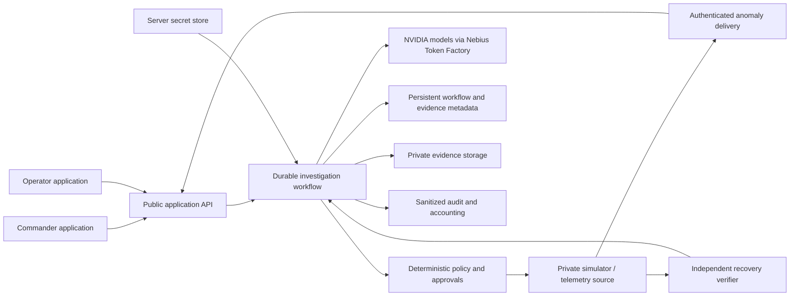

# FaultTrace architecture: current local implementation and public target

FT-009A separates Commander `/commander` and Operator `/operator`. Both consume
one server-backed workflow snapshot; the pages do not own separate incident,
task, evidence, approval or recovery stores. Each tab polls the same API. Route
identity changes presentation only: it is not authentication or authorization.
No public deployment or paid infrastructure is created by this checkpoint.

## Target boundaries

The diagram is the target, not a deployment claim. An anomaly delivers public
measurements and references, not simulator fault labels or answer keys. The
model proposes bounded observations. Application policy validates references,
capabilities, context freshness and budgets. A human approves a registered
simulated correction; a separate verifier derives recovery from subsequent
measurements. Neither a model response nor an operator completion grants recovery.

| Boundary | Exists now | Future / required gate |
| --- | --- | --- |
| Application and API | React/Vite pages, local FastAPI, loopback proxy, explicit refresh and polling | Public hosting, TLS, production SPA fallback for both routes, API ingress controls |
| Commander and Operator | Dedicated pages and canonical URLs; old connected query URLs map client-side to the correct route | **Server-enforced identity, roles and incident/evidence access are required before deployment.** Test direct API requests, not only hidden buttons. No role header or pathname is trusted as authority. |
| Durable workflow | Single-instance SQLite records, reserved planning turns, stale revisions, idempotent operations, serialized inference worker and recovery of interrupted attempts | Production durable job execution, multi-instance coordination, migrations, backup and restore; no external workflow engine is installed |
| NVIDIA through Nebius | Text `nvidia/NVIDIA-Nemotron-3-Nano-30B-A3B`; image `nvidia/Nemotron-3.5-Super-VL`; existing bounded transport and independent output validation | Broader connected adaptive evaluation and integrated evidence-based recovery reasoning remain unverified |
| Private simulator | In-process fixture module and private state; explicit clock steps produce timestamped measurements, alarms and public references | Private service/source boundary and authenticated event delivery; no hidden fault state or answer keys in public state or model context |
| Anomaly delivery | Explicit incident-start requests; evolving simulation only after explicit clock steps | Automated, authenticated and idempotent anomaly ingestion/event transport; no real sensor feed or automatic delivery exists |
| Workflow/evidence persistence | Local SQLite, private metadata-stripped upload files, ignored sanitized receipt ledger; no history migration for route separation | Production database/object storage, access controls, retention and operational backup policy; no cloud database/bucket is provisioned |
| Secrets | Backend-only NEBIUS_API_KEY environment; inference disabled by default; no key in browser, URLs, Git or evidence | Managed server-side secret storage and rotation; browser-facing APIs must never accept provider keys |
| Logs/accounting | Persisted wall-clock audit events, sanitized receipts/status codes, known/unknown token accounting; private local artifacts ignored | Protected centralized logs/monitoring and retention; no raw reasoning, provider bodies, headers, credentials or private uploads in public logs |
| Policy and verifier | Registered observation IDs, revision/reference validation, four planning turns, no automatic retry; separate human-approved simulation action and sample-based recovery policy | Server role authorization and broader scenario evaluation; no real equipment-control connection or general industrial safety claim |

## Partner-integration roadmap

Current orchestration is **custom Python with SQLite**. LangChain and LangGraph
are not current dependencies. None of the plans below requires an orchestration
migration. Existing NVIDIA inference through Nebius is retained; the additional
partner work and balance/offer checks below are not implemented or verified.

| Partner / status | Dependencies and planned scope | Acceptance before use or claiming integration |
| --- | --- | --- |
| **Nebius Token Factory — conditional budget check** | Retain NVIDIA runtime inference. Verify credited balance before budgeting evaluation or hosted-demo usage. | Privately confirm usable credited balance, expiry/restrictions and verification date; approve a bounded allocation before calls. Do not assume an offer was redeemed or that unknown usage is zero. |
| **LangSmith — planned, optional, after CI** | Passing CI, independently reviewed references and an approved export policy. Add evaluation/observability without replacing the custom workflow. | Deterministic evaluators measure contract validity, numeric accuracy and abstention against reviewed references; retain measured latency and actual known/unknown usage separately. Test evaluators against independently expected cases and verify redaction/export controls. Credentials, private images and raw reasoning are excluded by default. |
| **Tavily — planned, after the core connected journey** | A confirmed equipment model and restricted official manufacturer domains; no lookup inferred solely from assignment or an uncertain photo label. | Useful manufacturer-document lookup with visible citations to actual sources. Test missing documents, model mismatch, off-domain results and malicious document text. Retrieved material remains untrusted reference context, never observed evidence or correction authority. No bonus/integration claim before functional verification. |
| **Toloka — conditional offer assessment** | Independently labeled photo evaluation plan and permission/privacy review before sharing any data. | Confirm offer eligibility, reviewer suitability, credit coverage, actual cost and turnaround before use. Approve labeling instructions, independent review/disagreement handling and source/permission records; do not invent labels or treat preliminary estimates as calibrated truth. |
| **Tandem — deferred, not selected** | No concrete FaultTrace benefit has been established. | Reconsider only after a specific benefit and bounded acceptance test are documented, with dependency/privacy/cost review. No account, package or data transfer is selected now. |

These are planning decisions, not account creation, offer redemption, data export
or runtime changes. New spending and external-data use need applicable approval.
Track unverified gates in the [submission tracker](submission.md#partner-roadmap-gates-planned-only).

## FT-009B collection boundary

Camera/file uploads on assigned F-17/V-08 tasks use reference-photo purpose and
collected status; upload alone requests no inference. FT-010 adds a separate
explicit photo-observation contract through the existing worker/transport/ledger,
with contract/revision metadata, no replay and no historical receipt rewrite.
Task assignment does not prove photographed identity or instrument type. Actual
stored images and separate human/model records are shown in both workspaces.
Limits/private normalization persist; camera orientation is applied before
metadata removal. The API advertises the collection capability so newer UI
cannot accidentally use older analysis semantics. No migration, server restart,
provider call or recovery-policy change. See [photo evidence](photo-evidence.md)
for unverified analog/valve capabilities and actual source/license requirements.

## Evidence integration: actual scope

Both workspaces present the same real collections together, with distinct scope:

- `journey.observations`: simulated human pressure/position reports. These and
  stored simulator samples feed the deterministic fixture correction assessment.
- `evidence`: image uploads or structured reports for application-created
  observation tasks. NVIDIA image results are explicitly model interpretations,
  with their original source, validation and accounting. Human reports are not
  image-verified. FT-011 includes a bounded, validated photographic-claim projection
  in planner context, with original readings/units, compatibility, unknown identity,
  freshness and human/model disputes. Raw label text stays excluded. Explicit
  handoff enables clarification/escalation; no photographic claim satisfies the
  deterministic correction checklist. [FT-011 boundary](photo-planning.md).
- Planning receipts/proposals and human correction approval remain different
  records with different authority. No record is migrated or duplicated by UI.

**Photo model claims do not satisfy the simulated correction assessment.** New
FT-012 investigations project independently entered, compatible human task reports
into the existing deterministic assessment using the same evidence IDs as planning
and approval. Human confirmation/dispute preserves model and human sources; model
values never prefill a report. Unreviewed, conflicting or stale evidence blocks
approval. Registered simulated action and telemetry verification remain separate
authority boundaries. Historical runs retain the legacy parallel streams without
migration. This is application integration, not verified live AI recovery reasoning.
[Unified journey and offline review](unified-investigation.md).

The independent verifier consumes fresh post-correction samples and the execution
boundary, not private simulator outcomes or an LLM declaration. Maintenance
completion is separate. Thresholds and times are declared synthetic fixture
constraints in [the recovery guide](recovery-journey.md), not industrial limits.
Simulated measurement time differs from wall-clock audit time.

## Route and workspace contract

Commander owns incident creation, process/telemetry review, deterministic
assessment, optional NVIDIA observation planning, correction approval, recovery
progress and audit. Operator owns assigned observation instructions, uploads,
explicit image analysis, structured reports/refusals and approved simulated
completion acknowledgment. Operator contains no incident-start, planner,
Commander-approval or simulation-clock controls. Server APIs remain unchanged:
these presentation boundaries are not enforceable production roles yet.

`/?mode=connected&view=operator` resolves to `/operator`; Commander/default
connected URLs resolve to `/commander`. Dedicated paths override obsolete mode/
view parameters; unrelated query parameters and fragments are retained. Normal
links, reload, browser back/forward and modified-click/new-tab navigation are
supported by the client router. `/?mode=sample` retains the separately labeled
browser-only sample preview, never substituted for unavailable server data.
Unknown paths show an explicit page-not-found view.

Existing 5180 preview: `/commander` and `/operator`; no backend restart is needed
for this frontend-only checkpoint. See [startup commands](recovery-journey.md)
only if no preview is running; do not reset an existing run. Production hosting
must serve the SPA entry for both routes and proxy `/api` correctly.

## Evidence and open validation

24 frontend tests include route resolution and static React markup of both pages,
shared incident/references, role-specific controls, image/refusal/analysis paths,
recovery, missing telemetry and loading/offline states. TypeScript/Vite build
passes. No new dependency, backend policy change, provider request or deployment.
Browser inventory is empty; in-app browser opening failed. Actual 1440x900 and
390x844 layout, keyboard focus, history navigation, route reload, upload/error
journeys and recovery walkthrough remain required visual checks. Both dedicated route URLs and the legacy query URL returned HTTP 200 on the
existing preview. Static markup, build and HTTP route responses are not browser acceptance. Server role/access
checks are a separate required deployment gate, not satisfied by these tests.
