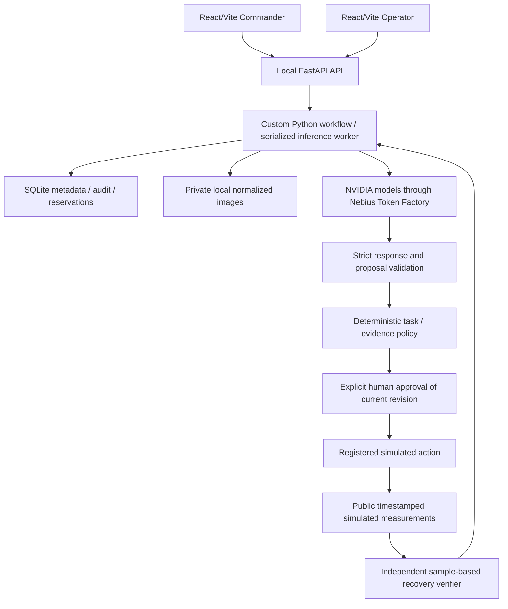

# Submission architecture — DRAFT / NOT SUBMITTED

Snapshot: `f2da0085a99061fe00f29ba91e5ba92b36d475fa`.
This describes the committed base, excluding Workers A/B's separate worktrees.
Canonical sources: [architecture](architecture.md),
[unified investigation](unified-investigation.md), [photo contract](photographic-analysis.md).

## Implemented local structure

This is a logical local data flow, not a deployed topology. UI route separation
changes presentation; it provides no authenticated role authority at this base.
`frontend/package.json`, `faulttrace/workflow/api.py`, `service.py`, `storage.py`
and `uploads.py` implement the local components. Each tab reads the same API.
SQLite is a deliberate single-instance substitute for the proposed hosted
database. Images remain private local files with normalization/metadata removal.

Text planning uses `nvidia/NVIDIA-Nemotron-3-Nano-30B-A3B`; vision uses
`nvidia/Nemotron-3.5-Super-VL` at the Nebius Token Factory API. Backend-only keys,
explicit opt-in, bounded requests and sanitized receipts separate inference from
browser state. Four planning reservations, idempotency, revision rejection,
interrupted-attempt handling and accounting constrain requests; failures do not
authorize automatic retries. `planning.py`, `photo_analysis.py` and
`planner_contract.py` own these boundaries.

## Authority and evidence

Private simulator fault state/answer keys do not enter investigator context.
Only public measurements and permitted evidence references do. Model output,
uploaded text and repository instructions have no authorization power. The
application validates the bounded action ID and citations before creating a task.
Raw photo labels are untrusted transcription; assignment is no identity proof.

Photos remain model claims even after contract validation. Independent human
reports preserve provenance and disagreements. Pressure cannot satisfy DP;
handle appearance cannot establish internal position. Unreviewed/stale/conflicting
evidence blocks approval. A compatible independent human report can contribute
to the simulated assessment; the model's number cannot directly authorize it.
See `investigation_evidence.py`, `human_observations.py`, `photo_planning.py`.

Approval binds the current revision. Operator acknowledgment records simulated
maintenance completion. `recovery_policy.verify` takes samples, execution tick
and current tick; it does not take an LLM judgment or hidden outcome. Recovery
requires at least five consecutive good post-action samples spanning 40 simulated
seconds, with fixture bands, alarms and freshness checked. A bad sample/relapse
fails verification. Recovery does not prove root cause or permanent repair.
See `recovery_policy.py` and [recovery guide](recovery-journey.md).

## Evidence strength and future gates

| Area | Current evidence | Remaining gate |
| --- | --- | --- |
| Model integration | Recorded narrow live calls, attributed user interactions and audits | General useful adaptation, numeric photo accuracy and complete live recovery walkthrough |
| Unified policy | Offline doubles, generated fixtures and simulated telemetry; 175 backend/51 frontend recorded passing checks | Broader evaluation; desktop/mobile/keyboard/camera/upload-progress acceptance |
| Local persistence | SQLite and private files; offline restart/idempotency tests, bounded user-reported restart evidence | Hosted storage, backup/restore, retention and multi-instance coordination |
| API/workspaces | Local FastAPI and two React routes | Public ingress/TLS, SPA routing, server identity/roles and incident/evidence authorization including direct requests |
| Operations | Local sanitized accounting, unknown usage preserved | Durable hosted execution, protected operational logs, budget and judge availability |

Live photo contract success does not close accuracy: 5000 psi differed from
preliminary 800–850 bar reviewer estimates, which are not calibrated truth.
The full unified recovery path uses offline doubles. Seeded review wall clocks
are fixtures, not production freshness evidence. See the [claim matrix](requirements-audit.md).

Future public API/durable hosting/authentication and deployment remain gates.
No production database, object storage, public judge URL or deployment acceptance
is claimed. B's unintegrated authentication work is excluded. LangSmith evaluation,
Tavily manufacturer lookup and Toloka labeling assessment remain planned and
conditional. LangChain/LangGraph are not current dependencies; the custom workflow
does not require migration. [Roadmap](architecture.md#partner-integration-roadmap).
